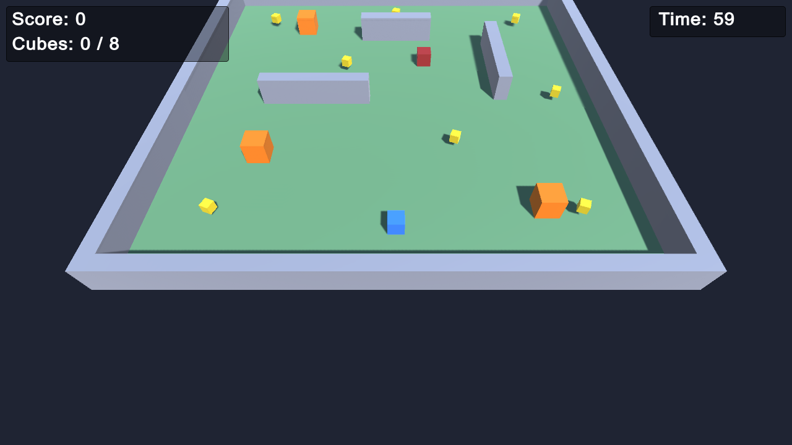
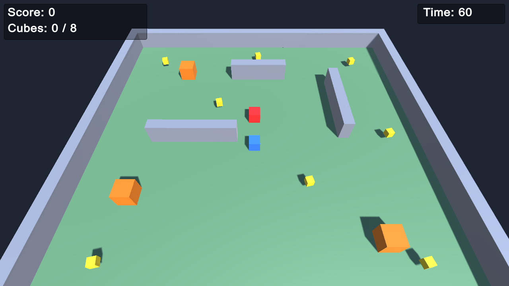
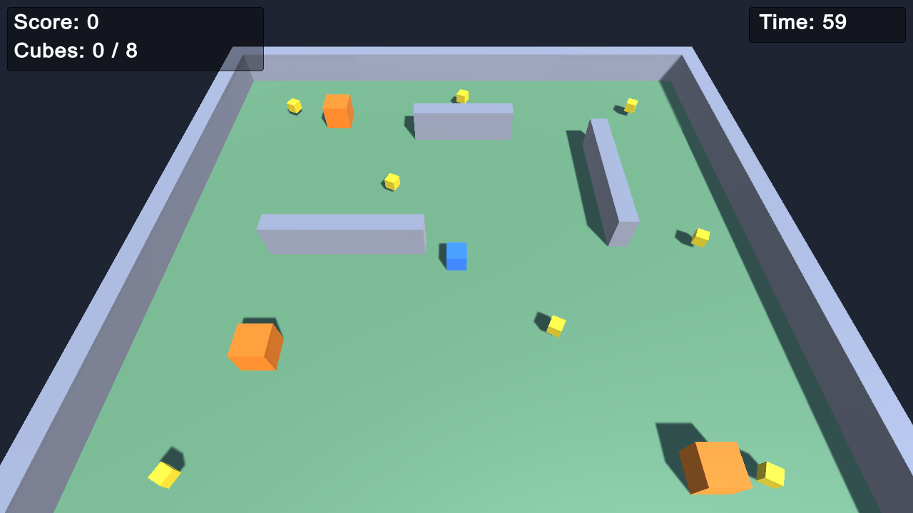
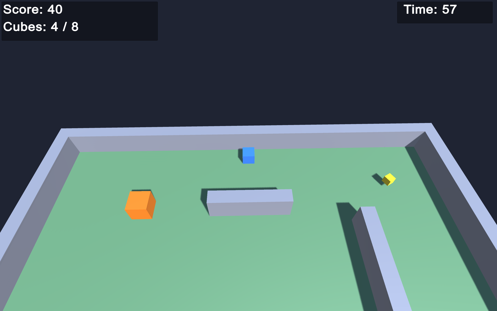
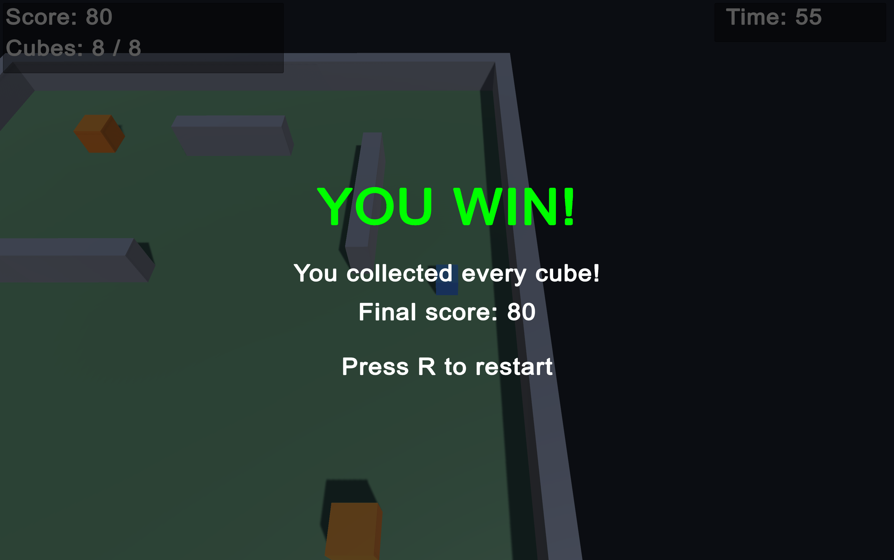
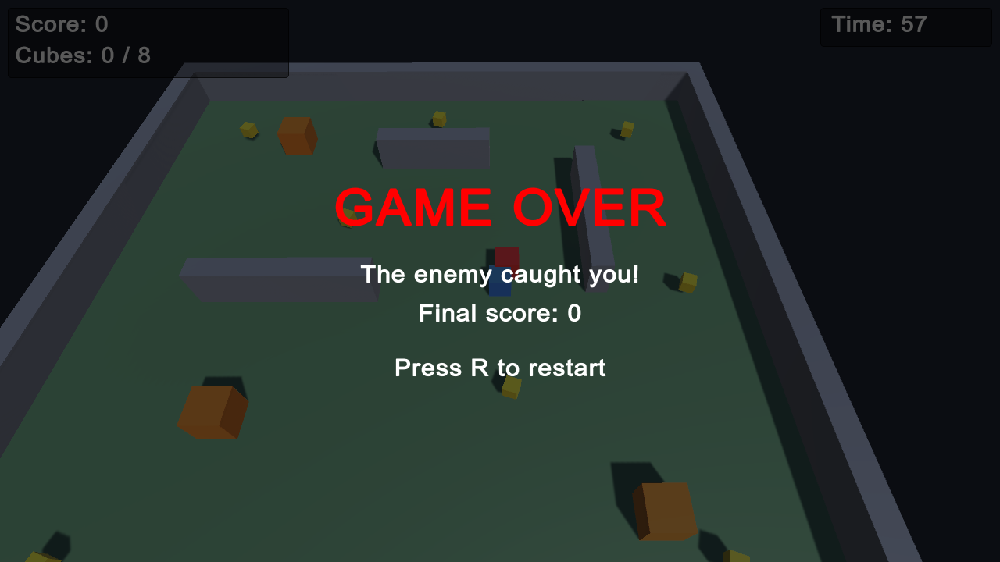

# Cube Collector

A simple 3D Unity game built from cubes. Move the blue cube, collect all 8 yellow cubes
before the timer runs out, and avoid the red enemy and the orange moving obstacles.

- **Unity version:** 6000.6.7f1 (built-in render pipeline, classic Input Manager)
- **Scene:** `Assets/Scenes/Main.unity`

## Controls
| Key | Action |
|---|---|
| W A S D / Arrow keys | Move |
| R | Restart (after win / lose) |

## Features
| Feature | How it works | Script |
|---|---|---|
| Player movement | Reads input in `Update`, sets Rigidbody velocity in `FixedUpdate` | `Scripts/Player/PlayerController.cs` |
| Collecting items | Yellow cubes have trigger colliders; `OnTriggerEnter` adds score and destroys the cube | `Scripts/Collectibles/Collectible.cs` |
| Score updates | `GameManager.AddScore` updates score and count; HUD shows it every frame | `Scripts/Managers/GameManager.cs`, `Scripts/UI/HUD.cs` |
| Enemy AI | Two-state machine: **Patrol** between waypoints, **Chase** when player is within 7 units, back to patrol beyond 12 | `Scripts/Enemy/EnemyAI.cs` |
| Obstacles | Grey walls block movement (static colliders). Orange hazards slide with `Mathf.PingPong` | `Scripts/Obstacles/MovingObstacle.cs` |
| Win condition | All 8 cubes collected | `GameManager.Win` |
| Lose conditions | Touch the enemy, touch a hazard, or the 60 s timer runs out | `PlayerController.OnCollisionEnter`, `GameManager.Update` |
| Camera | Follows the player from above in `LateUpdate` | `Scripts/Camera/CameraFollow.cs` |

## Project structure
```
Assets/
  Scenes/Main.unity
  Materials/            colours for each cube type
  Scripts/
    Player/             PlayerController
    Collectibles/       Collectible
    Enemy/              EnemyAI
    Obstacles/          MovingObstacle
    Managers/           GameManager (singleton: score, timer, win/lose)
    UI/                 HUD (OnGUI score, timer, end screen)
    Camera/             CameraFollow
    Tools/              DemoCapture (screenshot helper only, not gameplay)
  Editor/SceneBuilder.cs  builds the level: Tools > Cube Collector > Build Scene
```

## Screenshots
| | |
|---|---|
|  |  |
|  |  |
|  |  |

## How to run
1. Open the folder in Unity Hub (Add > project folder).
2. Open `Assets/Scenes/Main.unity` and press Play.
